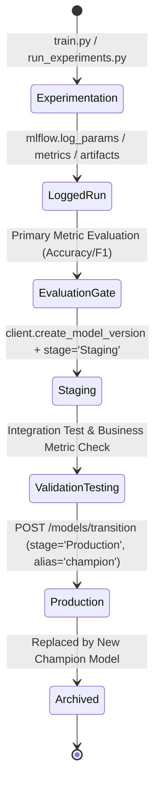

# MLOps System Architecture & Design Specification

This document details the architectural decisions, component interactions, data flows, and lifecycle governance implemented in the **MLOps Experiment Tracking & Model Registry Service**.

---

## 1. High-Level Architecture Diagram

```mermaid
flowchart TD
    subgraph Client & Interface Layer
        CLI[MLOps CLI / CI/CD Runner]
        API_USER[REST Client / Frontend]
        UI[MLflow Native Web UI :5000]
    end

    subgraph Service Layer [Docker Network: mlops_network]
        subgraph FastAPI Gateway [:8000]
            EP_TRAIN["POST /train (Async Queue)"]
            EP_EXP["GET /experiments"]
            EP_MOD["GET /models"]
            EP_TRANS["POST /models/transition"]
            EP_PRED["POST /predict"]
            CACHE[(In-Memory Model Cache)]
        end

        subgraph MLflow Server [:5000]
            TRACK[MLflow Tracking Service]
            REGISTRY[MLflow Model Registry]
        end
    end

    subgraph Storage Layer
        PG[(PostgreSQL Database :5432)]
        ARTIFACTS[(Local / Shared MLruns Volume)]
    end

    subgraph ML Core Engine
        TRAIN_SCRIPT[train.py]
        SWEEP_SCRIPT[run_experiments.py]
    end

    %% Flows
    CLI -->|Execute Experiments| SWEEP_SCRIPT
    SWEEP_SCRIPT --> TRAIN_SCRIPT
    TRAIN_SCRIPT -->|Log Params, Metrics, Artifacts| TRACK
    TRAIN_SCRIPT -->|Store Model & Plots| ARTIFACTS
    SWEEP_SCRIPT -->|Register Best Model| REGISTRY

    API_USER -->|REST Requests| FastAPI Gateway
    EP_TRAIN -->|Trigger Background Task| TRAIN_SCRIPT
    EP_EXP & EP_MOD & EP_TRANS <-->|Query / Transition| MLflow Server
    EP_PRED -->|Fetch Champion Model| CACHE
    CACHE -.->|Cache Miss| REGISTRY

    TRACK <-->|Store Runs, Params, Tags, Metrics| PG
    REGISTRY <-->|Store Model Metadata & Stages| PG
    TRACK <-->|Save/Load Artifacts| ARTIFACTS

    UI <--> MLflow Server
```

---

## 2. Component Breakdown & Responsibilities

### 2.1. PostgreSQL Relational Metadata Store (`postgres`)
- Stores MLflow relational schemas: `experiments`, `runs`, `params`, `metrics`, `tags`, `model_versions`, `registered_models`.
- Ensures ACID transactions and high concurrent query throughput for experiment searches and model transitions.

### 2.2. MLflow Tracking & Model Registry Server (`mlflow_server`)
- Centralized tracking engine exposed on port `5000`.
- Manages run lifecycles, compares metrics (`accuracy`, `f1_score`, `loss`), and logs artifacts.
- Enforces model versioning, aliases (`champion`, `challenger`), and lifecycle stages (`None` $\rightarrow$ `Staging` $\rightarrow$ `Production` $\rightarrow$ `Archived`).

### 2.3. ML Core Engine (`ml_core/`)
- **`train.py`**:
  - Modular model training supporting **Random Forest**, **Logistic Regression**, **Gradient Boosting**, and **Deep Learning (TensorFlow/Keras)**.
  - Reproducibility via strict global seeding (`PYTHONHASHSEED`, `numpy.random`, `random`).
  - Automatic model signature inference and input example logging.
  - Generates confusion matrix heatmap plots and classification report JSON artifacts.
- **`run_experiments.py`**:
  - Orchestrates systematic hyperparameter sweeps ($\ge 10$ distinct runs).
  - Automatically queries MLflow search API to identify the best run by evaluation metric.
  - Registers the champion model into the Model Registry and assigns the `Staging` stage.

### 2.4. FastAPI Application Gateway (`api/`)
- Non-blocking RESTful gateway with asynchronous background tasks (`POST /train`).
- Model inference cache (`MODEL_CACHE`) with dynamic TTL invalidation to serve low-latency predictions without disk/network overhead on repeated calls.
- Automated fallback strategy: if a requested stage (e.g. `Production`) is not yet promoted, gracefully falls back to `Staging` or the latest ready version with clear metadata reporting.

---

## 3. Model Governance & Lifecycle Workflow



---

## 4. Key Design Decisions

1. **Decoupled Architecture**:
   - Training logic in `ml_core/` is completely isolated from the web framework in `api/`.
   - Training can be executed in standalone CLI environments, distributed workers, or triggered asynchronously by the API.

2. **Multi-Stage Docker Builds**:
   - `api/Dockerfile` uses a multi-stage build: builder stage compiles dependencies; runner stage copies only the clean Python virtualenv and application source, resulting in a minimal, secure production container.

3. **In-Memory Model Caching**:
   - The `/predict` endpoint maintains a cached instance of the loaded MLflow PyFunc model with a 60-second refresh TTL, avoiding expensive disk/registry deserialization for high-throughput traffic.
